# Despliegue de la PokeDex en Azure App Service

Este documento explica paso a paso cómo se desplegó la aplicación **PokeDex** en **Microsoft Azure**, incluyendo los comandos, la configuración especial, los problemas encontrados y cómo se resolvieron.

**URL pública:** https://pokedex-johan-b0d3gae8akbscyen.westus3-01.azurewebsites.net

---

## 1. Arquitectura final

```
 Desarrollador ── git push ──► GitHub (repo pokedex)
                                   │
                                   ▼
                          GitHub Actions (CI/CD)
                     npm install → npm run build → npm prune
                                   │
                                   ▼
                  Azure App Service (Linux, Node 22, plan F1)
                         node server.js (Express)
                    ├─ Entrega dist/pokedex-angular
                    └─ Agrega encabezados de seguridad HTTP
                                   │
                                   ▼
                        Usuario (HTTPS, navegador)
                                   │
                                   ▼
                     PokéAPI (datos) / assets.pokemon.com (imágenes)
```

| Componente | Tecnología |
|---|---|
| Aplicación | Angular 14 (TypeScript) |
| Servidor web | Node.js + Express 4 (`server.js`) |
| Repositorio | GitHub: `ZZhades/pokedex` |
| CI/CD | GitHub Actions |
| Nube | Azure App Service, Linux, plan **Free F1**, región **West US 3** |

---

## 2. Preparación del entorno local

### 2.1 Node.js 16 portátil

Angular 14 requiere **Node.js 14 o 16**. El computador usado no tenía permisos de administrador (el instalador `.msi` pedía clave), así que se usó la **versión portátil** de Node, que no se instala:

1. Descargar `node-v16.20.2-win-x64.zip` desde https://nodejs.org/dist/v16.20.2/
2. Descomprimirlo en la carpeta de usuario.
3. Agregarlo al `PATH` de la terminal (**cmd**):

```cmd
set PATH=C:\Users\admloc30\Downloads\node-v16.20.2-win-x64\node-v16.20.2-win-x64;%PATH%
node -v
```

> El `set PATH` solo dura mientras la ventana de cmd esté abierta.

### 2.2 Git portátil

Igual que con Node, se usó **PortableGit** (https://git-scm.com/downloads/win):

```cmd
set PATH=C:\Users\admloc30\Downloads\PortableGit\cmd;%PATH%
git --version
```

### 2.3 Descargar el código y probarlo

1. Descargar `pokedex-angular.zip` del repositorio indicado en el caso de estudio y descomprimirlo.
2. Instalar dependencias y ejecutar en modo desarrollo:

```cmd
cd C:\Users\admloc30\Downloads\pokedex-angular
npm install
npm start
```

La app funcionó en `http://localhost:4200`:

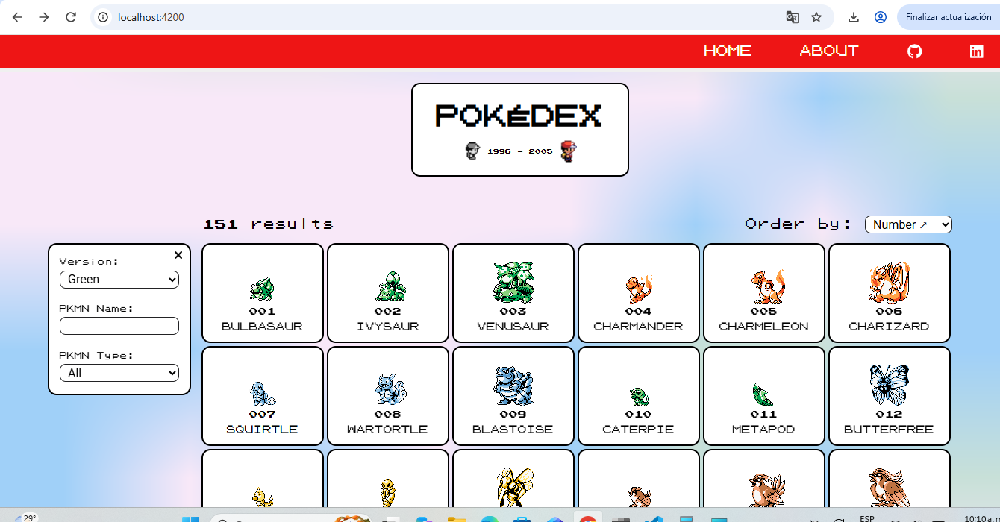

3. Probar la compilación de producción, que es la que se publica:

```cmd
npm run build
```

Genera la carpeta `dist/pokedex-angular`. Aparecen advertencias de *budget* (tamaño de archivos mayor al recomendado), que **no impiden** el funcionamiento.

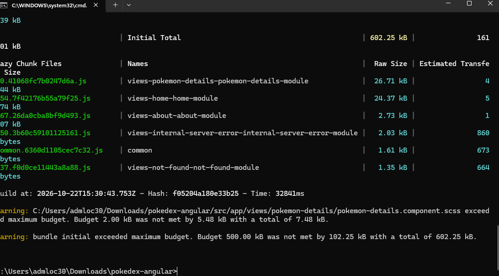

---

## 3. Subir el código a GitHub

1. Crear en GitHub un repositorio **público y vacío** llamado `pokedex`.

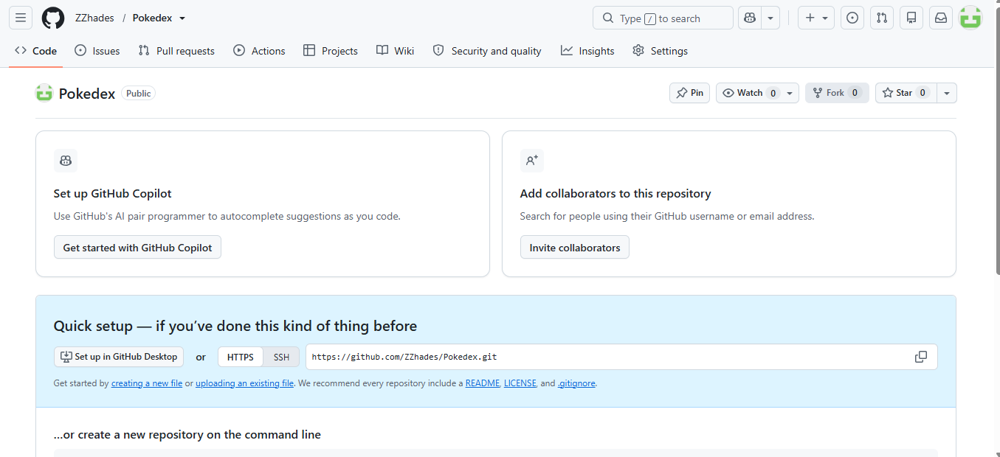

2. Verificar que el `.gitignore` excluya `/node_modules` y `/dist`.
3. Subir el código:

```cmd
git config --global user.name "Johan Ríos"
git config --global user.email "<correo de GitHub>"
git init
git add .
git commit -m "Código fuente inicial de la PokeDex"
git branch -M main
git remote add origin https://github.com/ZZhades/pokedex.git
git push -u origin main
```

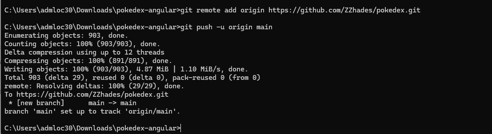

4. El proyecto original traía un workflow (`.github/workflows/pipelines.yml`) que ejecutaba pruebas y enviaba resultados a Codecov con un token del autor original. Como fallaría en cada push, se eliminó:

```cmd
git rm .github/workflows/pipelines.yml
git commit -m "Eliminar pipeline de pruebas del autor original"
git push
```

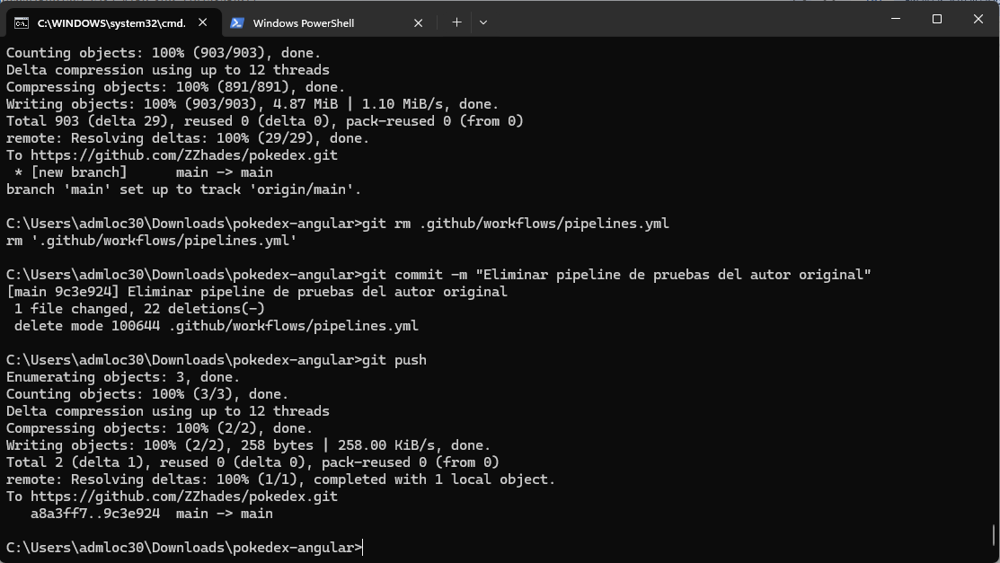

---

## 4. Primer intento: Azure Static Web Apps (no funcionó)

Inicialmente se intentó usar **Azure Static Web Apps** (plan Free), conectado al repositorio de GitHub.

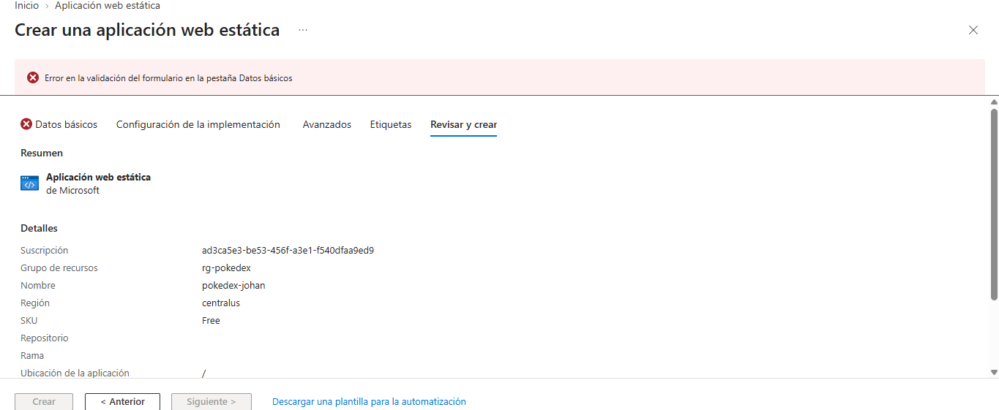

Al crear el recurso, Azure lo rechazó por una **política de regiones** de la suscripción de estudiante:

```
RequestDisallowedByAzure: Resource 'pokedex-johan' was disallowed by Azure:
This policy maintains a set of best available regions where your subscription
can deploy resources.
```


Static Web Apps solo existe en 5 regiones (East US 2, West US 2, Central US, West Europe y East Asia), y la suscripción solo permite **East US** y **West US 3**. Ninguna coincide.


**Decisión:** usar **Azure App Service**, que sí está disponible en West US 3 y también tiene un plan gratuito (F1).

---

## 5. Adaptar el proyecto para App Service

App Service **ejecuta un programa**, a diferencia de Static Web Apps, que solo entrega archivos. Por eso se agregó un servidor web pequeño con Express.

### 5.1 Instalar Express

```cmd
npm install express@4
```

Se usó la versión 4 porque Express 5 requiere Node 18 o superior.

### 5.2 Crear `server.js`

En la raíz del proyecto, con este contenido inicial:

```js
const express = require('express');
const path = require('path');

const app = express();
const PORT = process.env.PORT || 8080;
const DIST = path.join(__dirname, 'dist', 'pokedex-angular');

app.disable('x-powered-by');
app.use(express.static(DIST));

app.use((req, res) => {
  res.sendFile(path.join(DIST, 'index.html'));
});

app.listen(PORT, () => {
  console.log(`PokeDex escuchando en el puerto ${PORT}`);
});
```

| Línea | Función |
|---|---|
| `process.env.PORT \|\| 8080` | Azure indica el puerto con la variable `PORT`; en local se usa 8080 |
| `app.disable('x-powered-by')` | Oculta que el servidor usa Express |
| `express.static(DIST)` | Entrega los archivos compilados de Angular |
| `app.use` final | Cualquier ruta (por ejemplo `/about`) devuelve `index.html`, para que Angular maneje la navegación |

### 5.3 Corregir la ruta de las imágenes

Al probar con `node server.js`, la app cargaba los datos pero **no las imágenes**:

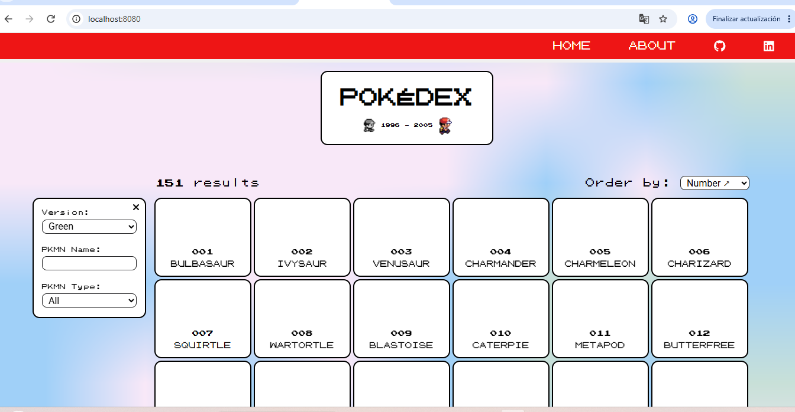

**Causa:** en `src/environments/environment.prod.ts`, la ruta de imágenes apuntaba a `/pokedex-angular/assets/images`, que era la ruta de GitHub Pages del autor original.

**Solución:** cambiarla a la raíz y recompilar:

```ts
imagesPath: '/assets/images',
```

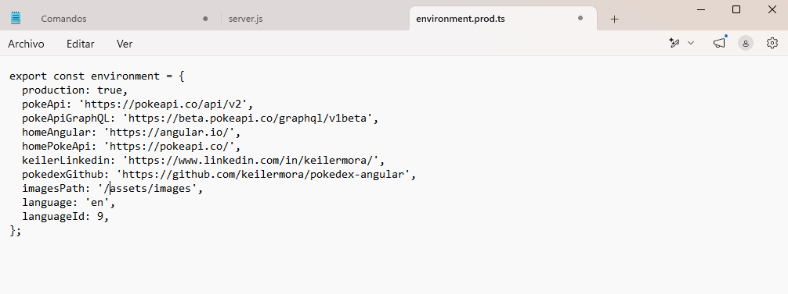

```cmd
npm run build
node server.js
```

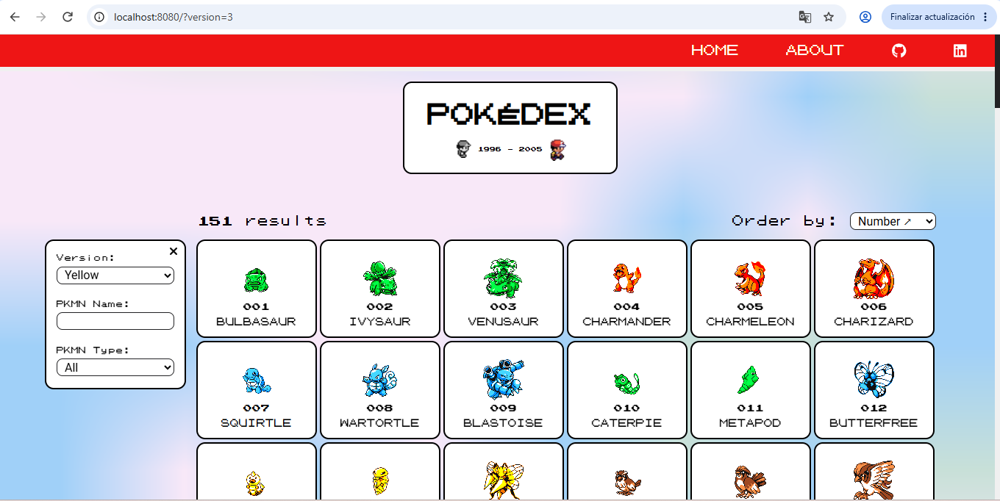

### 5.4 Subir los cambios

```cmd
git add .
git commit -m "Agregar servidor Express y corregir ruta de imágenes en producción"
git push
```

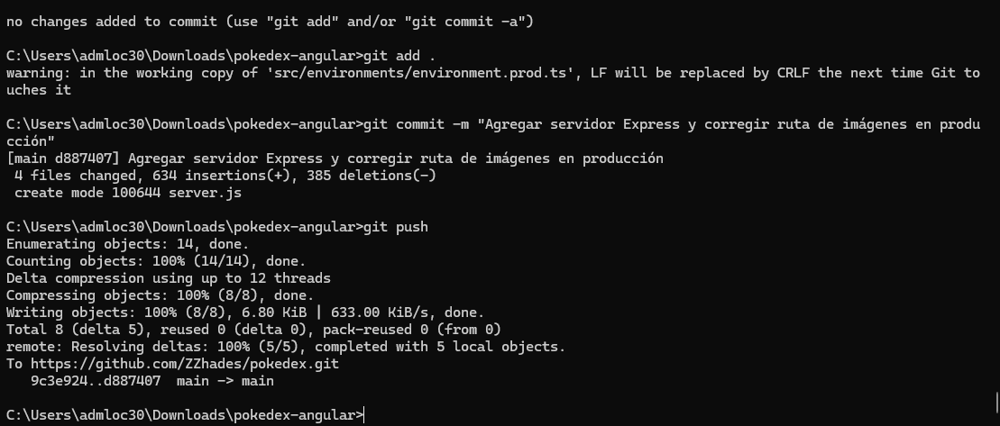

---

## 6. Crear la Aplicación web en Azure App Service

En el portal: **Crear un recurso** → **Aplicación web** → **Crear**.

### 6.1 Datos básicos

| Campo | Valor |
|---|---|
| Suscripción | Azure for Students |
| Grupo de recursos | `rg-pokedex` |
| Nombre | `pokedex-johan` |
| Publicar | Código |
| Pila | **Node 22 LTS** |
| Sistema operativo | **Linux** |
| Región | **West US 3** |
| Plan | `plan-pokedex`, **Gratis F1** |

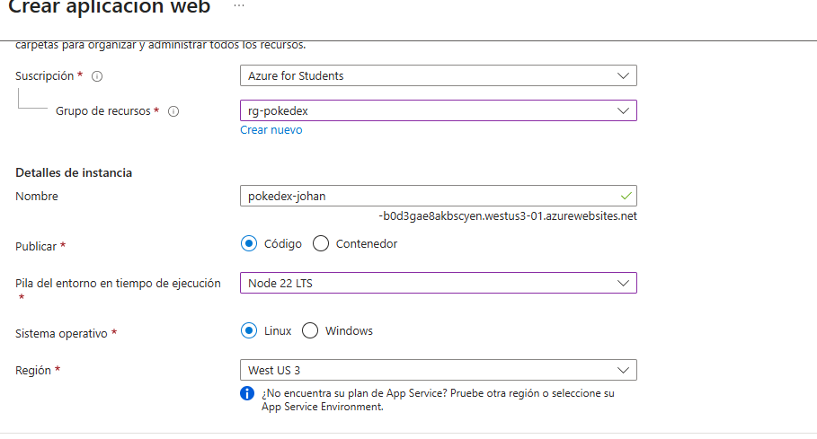

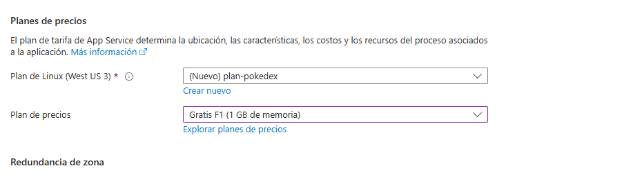

**¿Por qué Linux?** Node.js se ejecuta de forma nativa en Linux, es la configuración recomendada por Azure para aplicaciones Node y permite iniciar la app directamente con `node server.js`, sin configurar IIS ni `web.config` como en Windows.

### 6.2 Implementación

Con el plan F1 en Linux, Azure **no permite** configurar GitHub Actions durante la creación, así que se dejó deshabilitado y se configuró después.

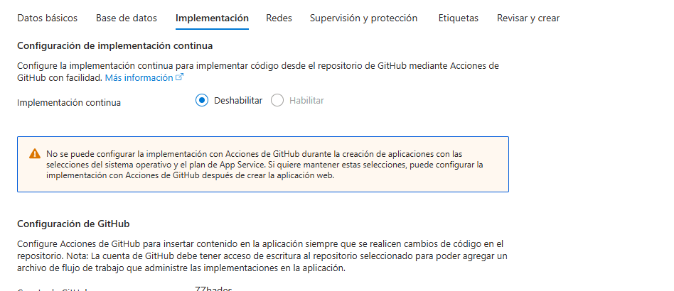

En **Supervisión** se desactivó Application Insights para no crear recursos adicionales. Luego: **Revisar y crear** → **Crear**.

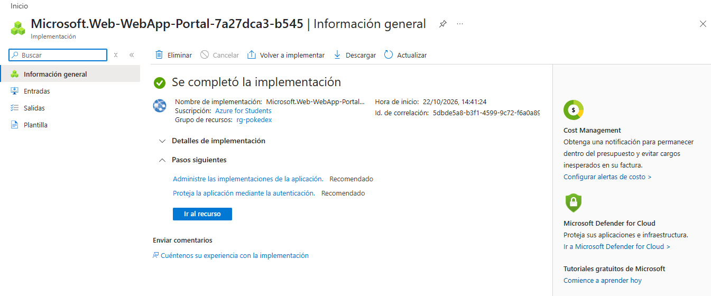

### 6.3 Comando de inicio

Por defecto App Service ejecuta `npm start`, que en este proyecto inicia el servidor de **desarrollo** de Angular. Se cambió en **Configuración → Configuración de la pila → Comando de inicio**:

```
node server.js
```

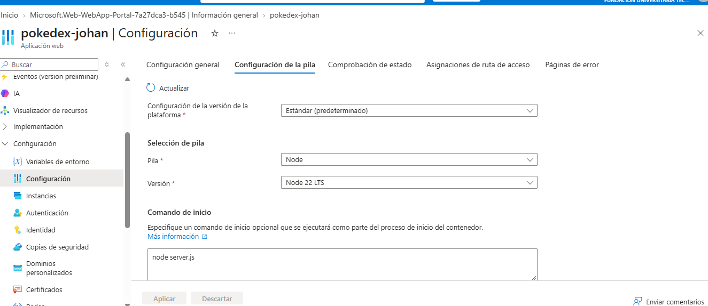

### 6.4 Conectar GitHub (Centro de implementación)

**Implementación → Centro de implementación → Configuración**:

| Campo | Valor |
|---|---|
| Origen | GitHub |
| Organización | ZZhades |
| Repositorio | pokedex |
| Rama | main |
| Flujo de trabajo | Agregar un flujo de trabajo |

Al guardar, Azure crea en el repositorio el archivo `.github/workflows/main_pokedex-johan.yml` y lanza un despliegue.

### 6.5 Ajustar el workflow de GitHub Actions

El workflow generado por Azure tenía dos problemas para este proyecto:

1. Usaba **Node 22** para compilar, y el proyecto es de Angular 14.
2. Ejecutaba `npm run test`, que abre Karma con Chrome en modo observación y **nunca termina**.

Se editó directamente en GitHub:

```yaml
      - name: Set up Node.js version
        uses: actions/setup-node@v3
        with:
          node-version: '16.x'

      - name: npm install, build, and test
        run: |
          npm install
          npm run build
          npm prune --production
```

`npm prune --production` elimina las dependencias de desarrollo después de compilar, para que el paquete que se sube a Azure sea más liviano.

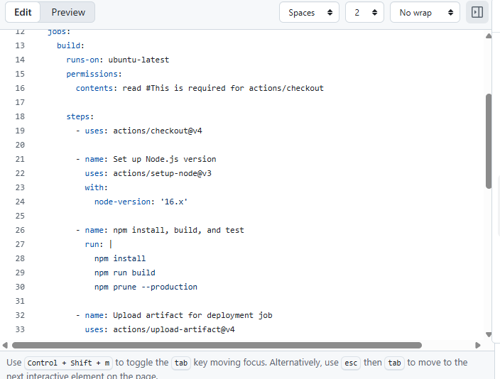

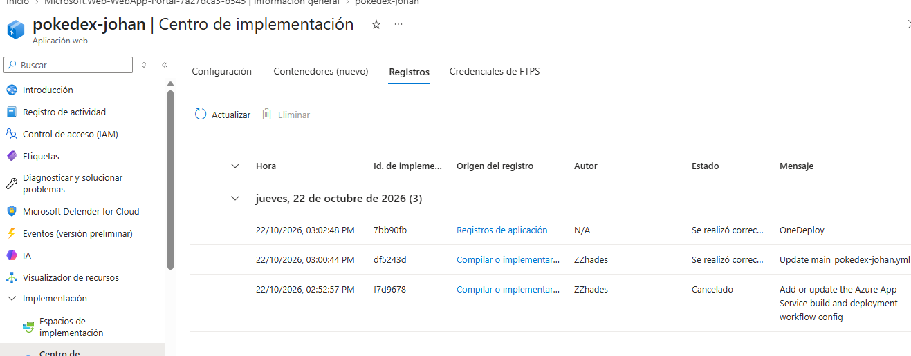

### 6.6 Resultado

La aplicación quedó disponible en la URL pública:

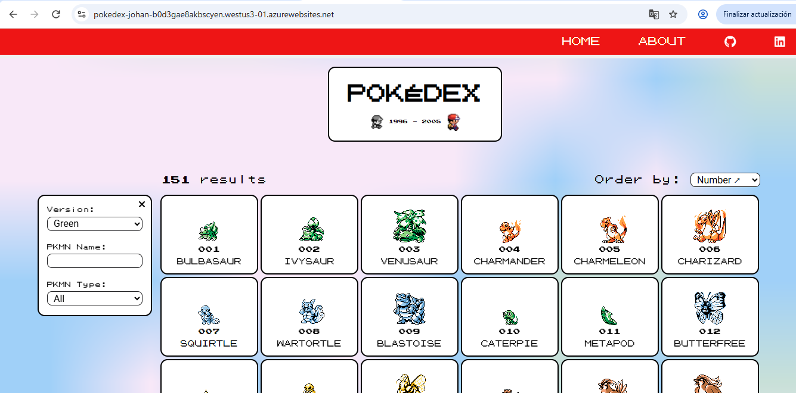

Para traer al equipo local el workflow creado por Azure:

```cmd
git pull
```

---

## 7. Encabezados de seguridad HTTP

### 7.1 Escaneo inicial: F

Antes de configurar nada, el escaneo en https://securityheaders.com dio **F**, con los 6 encabezados ausentes:

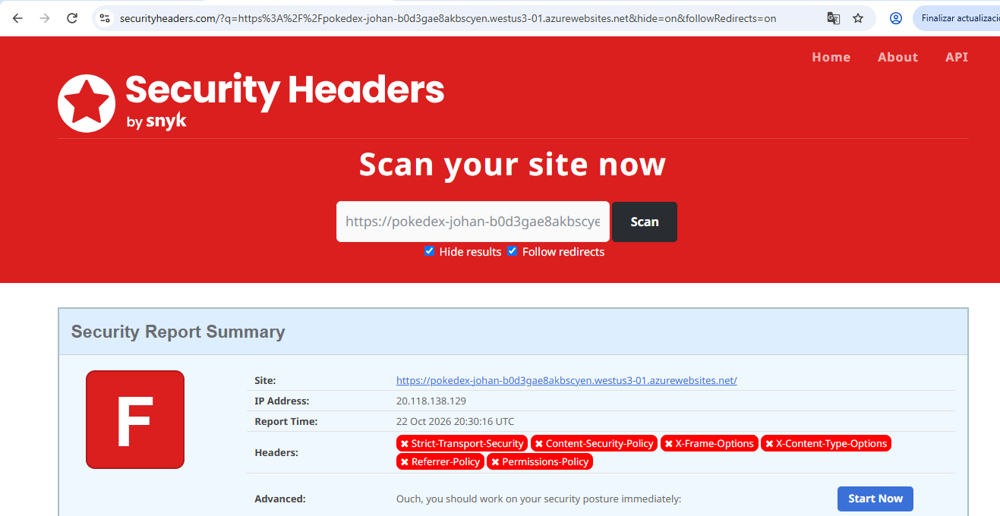

### 7.2 Preparar la app para un CSP estricto

El encabezado **Content-Security-Policy** bloquea el JavaScript escrito dentro del HTML. Para no romper la app se hicieron dos cambios:

**a) Quitar el script de GitHub Pages de `src/index.html`.** El autor original tenía un script en línea para que la app funcionara en GitHub Pages. En Azure ya no se necesita, porque `server.js` devuelve `index.html` para cualquier ruta.

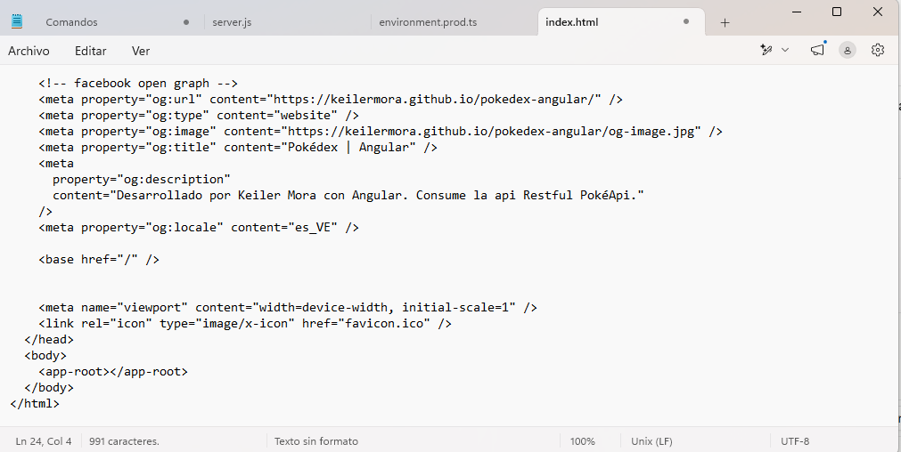

**b) Desactivar `inlineCritical` en `angular.json`.** En producción, Angular inserta CSS en el HTML y carga el resto con un atributo `onload="..."`, que el CSP bloquearía. Se agregó a la configuración `production`:

```json
"optimization": {
  "scripts": true,
  "styles": {
    "minify": true,
    "inlineCritical": false
  },
  "fonts": true
}
```

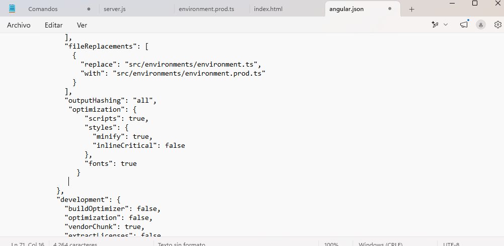

### 7.3 Agregar los encabezados en `server.js`

Se agregó un *middleware* que añade los encabezados a **todas** las respuestas:

```js
const CSP = [
  "default-src 'self'",
  "script-src 'self'",
  "style-src 'self' 'unsafe-inline' https://fonts.googleapis.com",
  "font-src 'self' https://fonts.gstatic.com",
  "img-src 'self' data: https://assets.pokemon.com",
  "connect-src 'self' https://beta.pokeapi.co https://pokeapi.co",
  "object-src 'none'",
  "base-uri 'self'",
  "form-action 'self'",
  "frame-ancestors 'none'"
].join('; ');

app.use((req, res, next) => {
  res.setHeader('Strict-Transport-Security', 'max-age=31536000; includeSubDomains');
  res.setHeader('Content-Security-Policy', CSP);
  res.setHeader('X-Frame-Options', 'DENY');
  res.setHeader('X-Content-Type-Options', 'nosniff');
  res.setHeader('Referrer-Policy', 'strict-origin-when-cross-origin');
  res.setHeader('Permissions-Policy', 'camera=(), microphone=(), geolocation=(), payment=(), usb=()');
  res.setHeader('Cross-Origin-Opener-Policy', 'same-origin');
  next();
});
```

| Encabezado | Protege contra |
|---|---|
| Strict-Transport-Security (HSTS) | Conexiones sin cifrar: obliga a usar HTTPS durante un año |
| Content-Security-Policy (CSP) | Inyección de scripts (XSS): solo permite recursos de orígenes autorizados |
| X-Frame-Options | Clickjacking: impide incrustar la página en un iframe |
| X-Content-Type-Options | Que el navegador "adivine" el tipo de archivo (MIME sniffing) |
| Referrer-Policy | Filtración de URLs completas a otros sitios |
| Permissions-Policy | Uso de cámara, micrófono, ubicación, pagos y USB |
| Cross-Origin-Opener-Policy | Manipulación de la ventana desde otros orígenes |

| Directiva del CSP | Motivo |
|---|---|
| `script-src 'self'` | Solo los scripts propios; bloquea scripts en línea |
| `style-src 'unsafe-inline' fonts.googleapis.com` | Angular 14 inserta estilos en sus componentes; la fuente viene de Google Fonts |
| `font-src fonts.gstatic.com` | Archivos de la fuente Roboto |
| `img-src assets.pokemon.com data:` | Imágenes grandes del detalle de cada Pokémon |
| `connect-src beta.pokeapi.co pokeapi.co` | API de donde se obtienen los datos |
| `object-src 'none'` | Bloquea plugins (Flash, etc.) |
| `frame-ancestors 'none'` | Equivalente moderno de X-Frame-Options |

### 7.4 Verificación local

```cmd
npm run build
node server.js
```

Se navegó por la lista, el detalle de un Pokémon y la página About con las herramientas de desarrollador abiertas (**Ctrl + Shift + I**). La consola no mostró bloqueos del CSP (**No issues**).

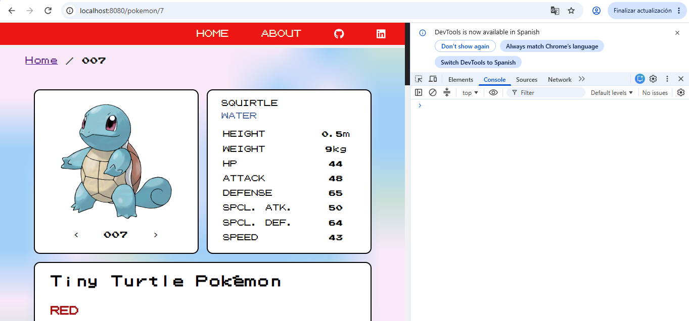

### 7.5 Despliegue

```cmd
git add .
git commit -m "Agregar encabezados de seguridad HTTP y ajustar build para CSP"
git push
```

GitHub Actions compiló y desplegó automáticamente:

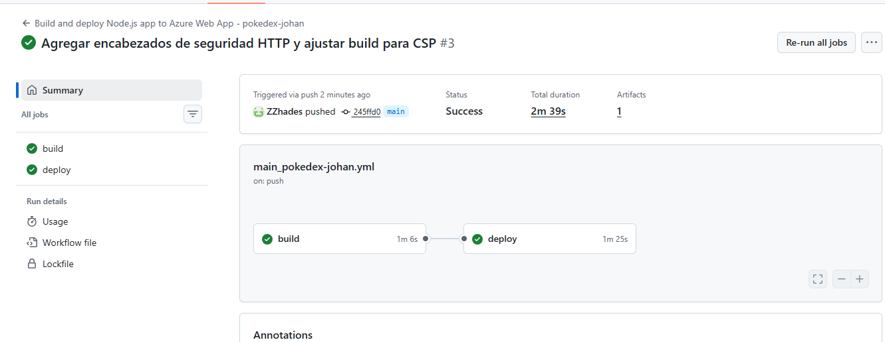

### 7.6 Escaneo final: A+

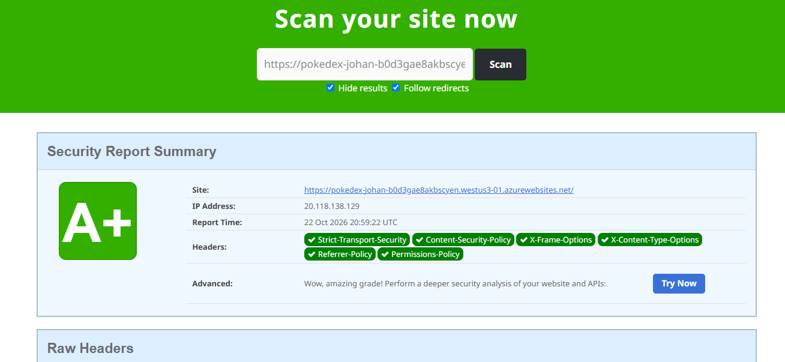

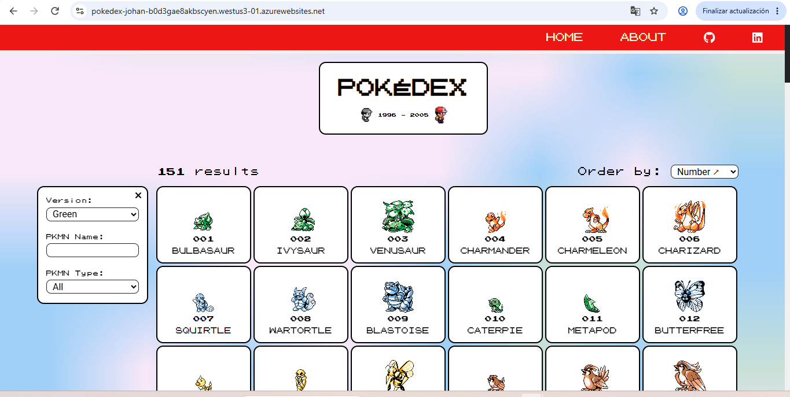

---

## 8. Auditoría adicional: SSL Labs

Se analizó la configuración HTTPS en https://www.ssllabs.com/ssltest/ con resultado **A+** y soporte de **TLS 1.3**. El certificado de `azurewebsites.net` es administrado por Microsoft.

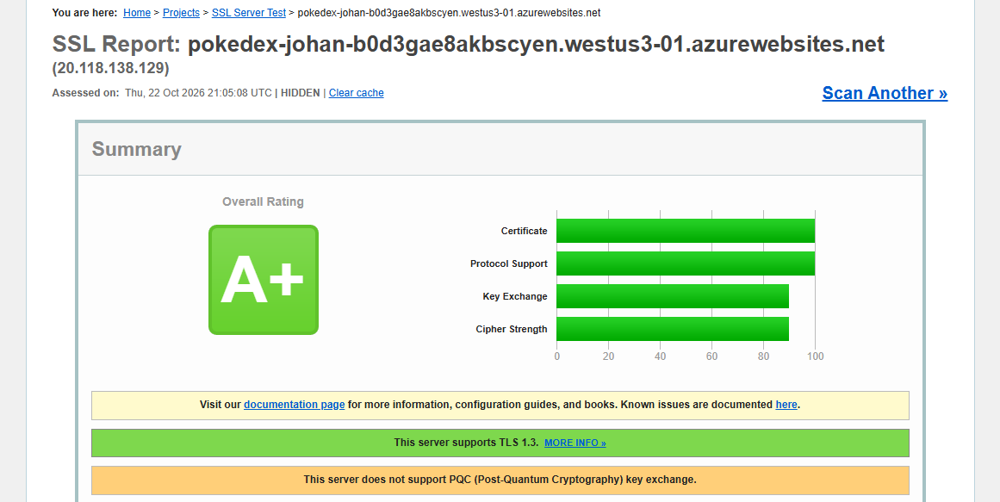

---

## 9. Resultados

| Prueba | Antes | Después |
|---|---|---|
| securityheaders.com | **F** (0 de 6 encabezados) | **A+** (6 de 6 encabezados) |
| SSL Labs | — | **A+** (TLS 1.3) |

---

## 10. Problemas encontrados y soluciones

| Problema | Causa | Solución |
|---|---|---|
| `"nvm" no se reconoce...` | nvm no estaba instalado | Se usó Node directamente |
| El instalador `.msi` de Node pidió clave de administrador | Equipo de la universidad sin permisos de administrador | Node y Git en versión **portátil** (.zip) |
| `"node" no se reconoce...` después del `set` | Se escribió `PATCH` en lugar de `PATH` | Corregir el comando y agregar `;%PATH%` |
| `%PATH%` no se reconoce como cmdlet | Se estaba usando PowerShell en lugar de cmd | Escribir `cmd` o usar `$env:Path` |
| `server.js` quedó de 0 bytes | El Bloc de notas no guardó el contenido | Guardar con **Archivo → Guardar** y verificar con `dir` |
| Static Web App: `RequestDisallowedByAzure` | La suscripción de estudiante solo permite East US y West US 3, y Static Web Apps no existe en ellas | Cambiar a **App Service** en West US 3 |
| En producción no cargaban las imágenes | `imagesPath` apuntaba a `/pokedex-angular/` (ruta de GitHub Pages) | Cambiar a `/assets/images` |
| El workflow de Azure no terminaba | Ejecutaba `npm run test` (Karma en modo observación) con Node 22 | Quitar las pruebas y usar Node 16 para compilar |
| Riesgo de que el CSP rompiera la app | Script en línea en `index.html` y `inlineCritical` de Angular | Eliminar el script y desactivar `inlineCritical` |

---

## 11. Resumen de comandos

```cmd
:: Entorno (en cada ventana nueva de cmd)
set PATH=C:\Users\admloc30\Downloads\node-v16.20.2-win-x64\node-v16.20.2-win-x64;%PATH%
set PATH=C:\Users\admloc30\Downloads\PortableGit\cmd;%PATH%

:: Proyecto
cd C:\Users\admloc30\Downloads\pokedex-angular
npm install
npm install express@4
npm run build
node server.js

:: Publicar cambios (dispara el despliegue automático)
git pull
git add .
git commit -m "mensaje"
git push
```
