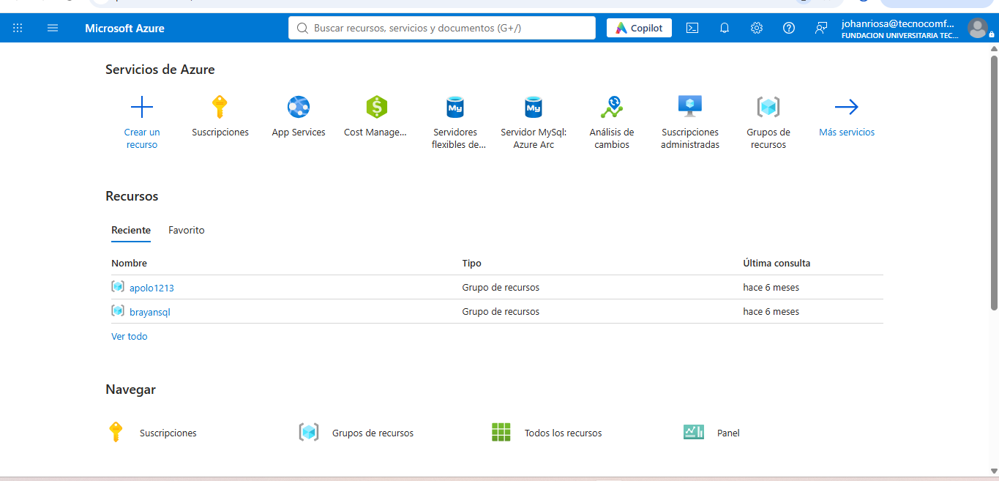
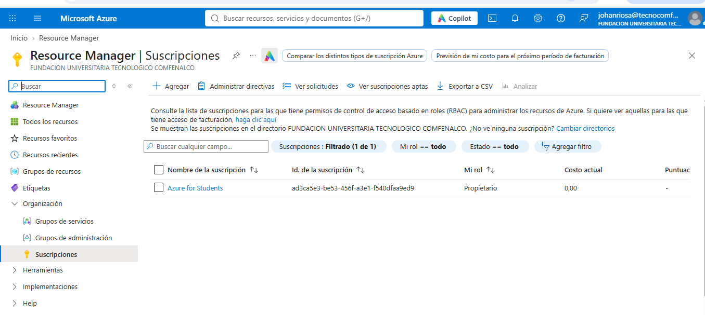
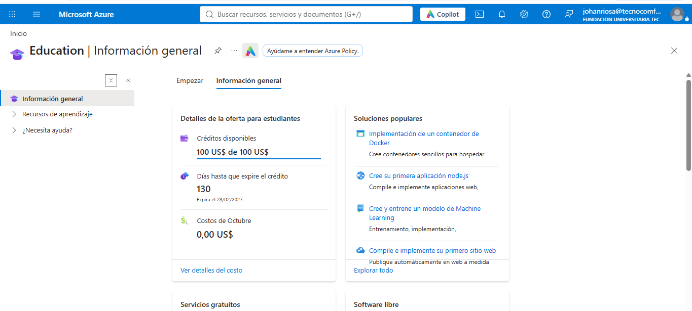
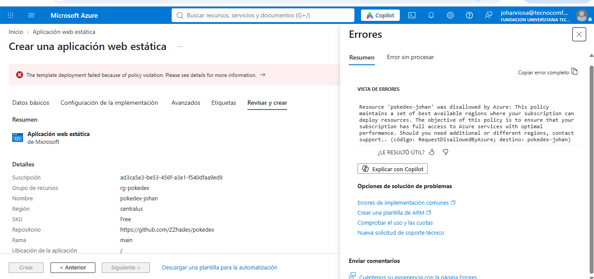
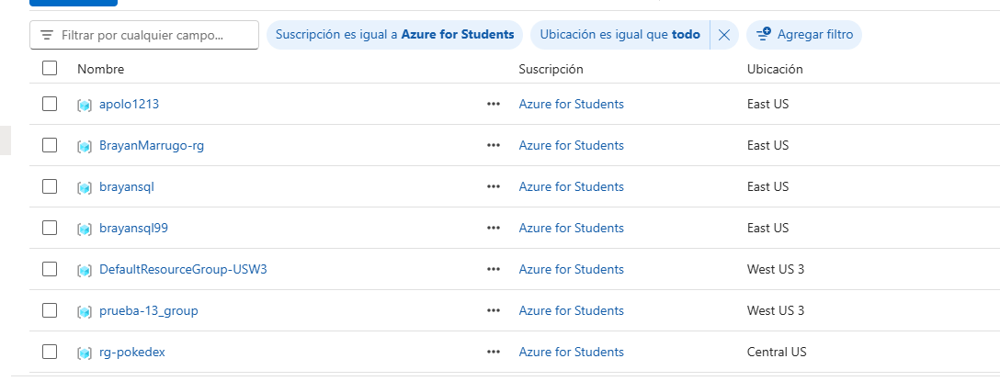

# PokeDex en Azure

Despliegue de la aplicación **PokeDex** (Angular 14) para Pueblo Paleta Inc. en la nube pública **Microsoft Azure**, usando la oferta **Azure for Students**.

- **Autor:** Johan Zair Ríos Almeida
- **Asignatura:** Computación Distribuida, Fundación Universitaria Tecnológica Comfenalco
- **Aplicación en línea:** https://pokedex-johan-b0d3gae8akbscyen.westus3-01.azurewebsites.net
- **Resultado en securityheaders.com:** A+
- **Resultado en SSL Labs:** A+

> El proceso de despliegue está documentado paso a paso en [Despliegue.md](Despliegue.md). Este archivo explica cómo se crea la cuenta en la nube y su configuración inicial.

---

## Tutorial: crear la cuenta de Azure for Students

### ¿Qué es Azure for Students?

Es una oferta de Microsoft para estudiantes de instituciones de educación superior. Incluye:

- USD 100 de crédito durante 12 meses (o hasta que se acabe el crédito).
- Acceso a servicios con planes gratuitos, como **App Service F1**, que es el que se usó en este proyecto.
- **No requiere tarjeta de crédito.** La verificación se hace con el correo institucional.

### Requisitos previos

1. Ser estudiante activo de una institución acreditada.
2. Tener acceso al **correo institucional** (en este caso, el correo de la Fundación Universitaria Tecnológica Comfenalco), porque allí llega el código de verificación.
3. Un número de celular para la verificación por SMS.

> **Recomendación:** si se usa un computador compartido (por ejemplo, de un laboratorio), hacer el registro en una **ventana de incógnito** para no mezclar cuentas, y cerrar sesión al terminar.

### Paso 1: Entrar a la oferta

1. Abrir el navegador e ir a **https://aka.ms/azure4students**
2. Hacer clic en **"Start free"** / **"Activar ahora"**.

> ⚠️ No confundir con la "Azure free account" normal, que sí pide tarjeta de crédito.

### Paso 2: Iniciar sesión con el correo institucional

1. Escribir el **correo institucional**.
2. Como la universidad usa Microsoft 365, el correo ya es una cuenta Microsoft y redirige al inicio de sesión de la institución.
3. Ingresar la contraseña del correo institucional.

### Paso 3: Verificación académica

Microsoft verifica que la persona es estudiante:

- Puede ser **automático**, por el dominio del correo institucional.
- O mediante un **código** enviado al correo institucional, que se copia en el formulario. Si no llega, revisar la carpeta de spam u "Otros".

### Paso 4: Completar el perfil

1. País: **Colombia**.
2. Nombre, apellido y fecha de nacimiento.
3. **Verificación por teléfono:** ingresar el número de celular, recibir el SMS y escribir el código.
4. Aceptar el **acuerdo de suscripción**.
5. Clic en **"Registrarse"** y esperar unos minutos mientras se crea la suscripción.

### Paso 5: Entrar al portal de Azure

Al terminar, Azure redirige al **portal**: https://portal.azure.com



---

## Configuración inicial de la cuenta

### 1. Verificar la suscripción

1. En el buscador del portal escribir **"Suscripciones"**.
2. Debe aparecer la suscripción **Azure for Students**, con el rol **Propietario** y costo actual **0,00**.



### 2. Revisar el crédito disponible

1. En el buscador escribir **"Education"** (Centro de educación).
2. En **"Detalles de la oferta para estudiantes"** se ve el crédito disponible y la fecha de vencimiento.

En esta cuenta: **USD 100 de USD 100 disponibles**, con vencimiento el **28/02/2027**.



### 3. Crear un grupo de recursos

Un **grupo de recursos** es un contenedor lógico que agrupa todos los recursos de un proyecto. Si se elimina el grupo, se elimina todo lo que contiene.

Para este proyecto se creó el grupo **`rg-pokedex`** (se puede crear desde el formulario de cualquier recurso, con la opción **"Crear nuevo"**).

### 4. Identificar las regiones permitidas

Las suscripciones de Azure for Students tienen una **política** que solo permite crear recursos en ciertas regiones. Si se intenta crear un recurso en otra región, aparece este error:

```
RequestDisallowedByAzure: This policy maintains a set of best available regions
where your subscription can deploy resources.
```



La lista de regiones permitidas **no aparece** en el mensaje de error. Para averiguarla, se revisó en **"Grupos de recursos"** la columna **Ubicación** de los recursos que ya existían en la cuenta, y que por lo tanto se habían creado sin problemas: **East US** y **West US 3**.



Por esta razón la aplicación se desplegó en **West US 3**. Los detalles están en [Despliegue.md](Despliegue.md).

### 5. Buenas prácticas de costo

- Usar siempre planes **gratuitos** (Free / F1) para proyectos académicos.
- No activar servicios adicionales que no se necesiten (por ejemplo, Application Insights).
- Revisar periódicamente el crédito en **Education** o en **Cost Management**.

---

## Resumen

| Elemento | Valor |
|---|---|
| Nube | Microsoft Azure |
| Oferta | Azure for Students (USD 100, sin tarjeta) |
| Suscripción | Azure for Students |
| Grupo de recursos | `rg-pokedex` |
| Región usada | West US 3 |
| Servicio | Azure App Service (Linux, plan Free F1) |
| Repositorio | https://github.com/ZZhades/pokedex |
